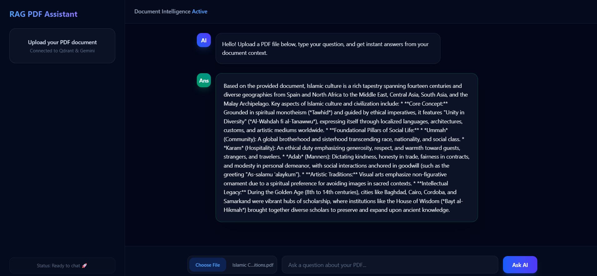
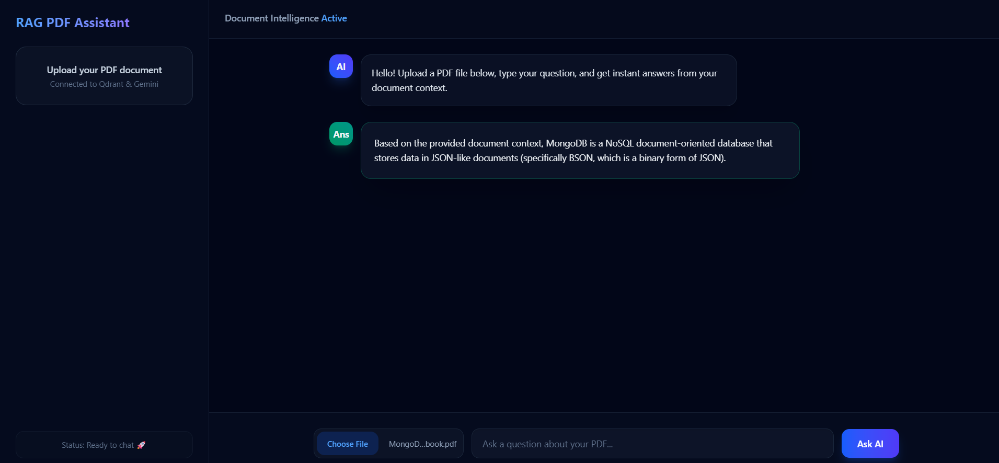

# 🚀 PDF AI RAG Assistant & Chatbot

An intelligent, production-grade Retrieval-Augmented Generation (RAG) web application that ingests uploaded PDF documents and enables users to interactively chat, summarize, and ask targeted questions about any document in real time. Built using a modern full-stack architecture with local embedded pipelines for zero-cost scalability.

## 🌐 Live Link

* Live Application: [Your Deployed Frontend URL Here]

## 📸 Screenshots

| Application Interface | PDF Ingestion & Chat Q&A |
| :---: | :---: |
|  |  |

## 📊 Core Features & Capabilities

* **Automated PDF Ingestion & Parsing:** Instantly extracts and cleans text content from uploaded PDF documents using `unpdf` and `RecursiveCharacterTextSplitter`.
* **Local Vector Embeddings:** Utilizes `@xenova/transformers` (`all-MiniLM-L6-v2`) locally to compute 384-dimensional vector embeddings without hitting external rate limits or API quotas.
* **Vector Search Engine:** Connects to Qdrant Cloud vector database powered by payload metadata filtering (`fileId`) for high-performance cosine similarity searches over isolated vectorized text chunks.
* **Context-Aware AI Answers:** Powered by the Google Gemini API (`gemini-3.5-flash-lite`), capable of precise contextual Q&A retrieval strictly grounded in user-provided document context.
* **Optimized Chunking & Batching:** Implements split-chunk sizing (500 chunk size with 200 overlap) and batch upserting to ensure connection stability and zero timeouts for large PDF documents.
* **Modern UI/UX:** Built with React, Vite, and Tailwind CSS featuring a dark-mode glassmorphism interface, loading states, and dynamic chat responses.

## 🛠️ Tech Stack & Deployment

* **Frontend:** React.js, Vite, Tailwind CSS, Axios
* **Backend & API:** Node.js, Express.js, Multer, `@xenova/transformers`, `@langchain/textsplitters`
* **Database & Storage:** Qdrant Cloud Vector Database (with payload keyword indexing)
* **AI & External APIs:** Google Gemini API (`gemini-3.5-flash-lite`)

## 📁 Folder Structure

```text
chat-with-pdf/
├── client/                   # Frontend React Application
│   ├── src/
│   │   ├── App.jsx
│   │   └── index.css
│   └── package.json
├── server/                   # Backend Node.js & Express API
│   ├── src/
│   │   ├── config/
│   │   ├── controllers/
│   │   ├── routes/
│   │   └── services/
│   ├── uploads/
│   ├── server.js
│   └── package.json
├── assets/                   # Application Screenshots
│   ├── screenshot1.png
│   └── screenshot2.png
└── README.md